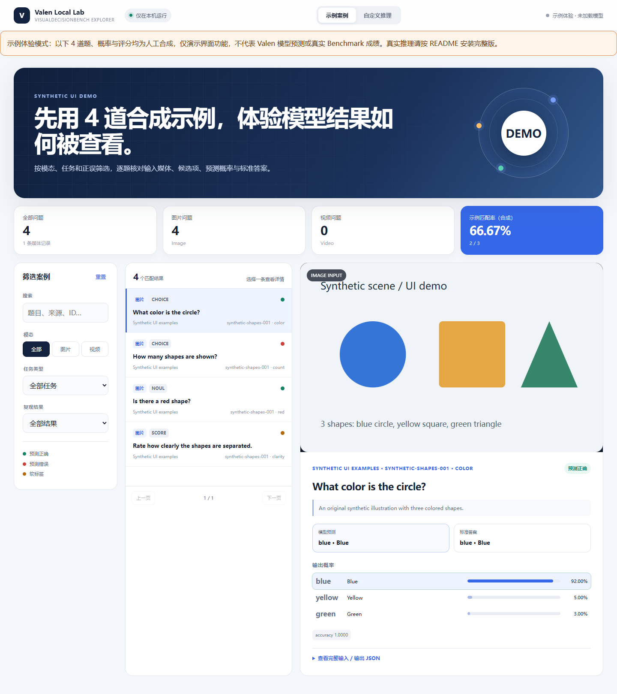

# Valen Local Lab

English · [简体中文](README.md) · [Releases](https://github.com/HUAN2022A/valen-local-lab/releases)

**Explore Valen-0.8B on Windows with a 6GB GPU: inspect multimodal decisions, compare probabilities, and run local inference.**



*The screenshot uses hand-authored synthetic examples. Its probabilities are not model predictions. The current interface is in Chinese; questions and outputs can be English.*

## What you can do

- Browse and filter image/video benchmark questions by task and prediction outcome.
- Inspect inputs, candidate answers, probability distributions, reference answers and JSON.
- Ask custom Choice, Noul or Score questions using text, images or video.
- Load the model on demand and release its GPU memory from the interface.

The full local reproduction covered **9,143 questions**, with **78.3784% accuracy across 8,843 hard-label questions** on an RTX 3060 Laptop GPU. This is our measured result, not an official combined benchmark score. See [results](valen-repro/RESULTS.md).

## Try the interface without a GPU

Install Git and [uv](https://docs.astral.sh/uv/), then run in PowerShell:

```powershell
git clone https://github.com/HUAN2022A/valen-local-lab.git
Set-Location valen-local-lab
.\start-demo.ps1
```

Open <http://127.0.0.1:8893/>. Four bundled synthetic examples let you try filtering, details, probabilities and JSON. No model or benchmark download is needed. The first run installs Python 3.11 and web dependencies. Demo mode does not run inference and clearly identifies synthetic data.

## Run the full lab

Tested environment: Windows 11, NVIDIA RTX 3060 Laptop 6GB, Python 3.11, PyTorch 2.6.0 with CUDA 12.4. The interface defaults to BF16; native full evaluation can require Windows shared-memory paging on a 6GB GPU.

```powershell
.\install.ps1 -Quantization
$py = Join-Path $PWD 'Valen\.venv\Scripts\python.exe'
& $py .\valen-repro\prepare.py
& $py .\valen-repro\run.py evaluate --data .\Valen\data\VisualDecisionBench\eval-image.jsonl --dtype native --quant none --execution shared_state --output .\Valen\output\visualdecisionbench-image-native
& $py .\valen-repro\run.py evaluate --data .\Valen\data\VisualDecisionBench\eval-video.jsonl --dtype native --quant none --execution shared_state --output .\Valen\output\visualdecisionbench-video-native
& $py .\valen-repro\verify.py --data .\Valen\data\VisualDecisionBench\eval-image.jsonl --output .\Valen\output\visualdecisionbench-image-native
& $py .\valen-repro\verify.py --data .\Valen\data\VisualDecisionBench\eval-video.jsonl --output .\Valen\output\visualdecisionbench-video-native
.\valen-repro\case-viewer\start-local.ps1
```

Open <http://127.0.0.1:8892/>. Stop with Ctrl+C. Both complete prediction files are required by the full explorer. Output directories must be new or empty. Full native evaluation took about 58 minutes on the tested machine; BF16 custom inference is a different precision profile.

Installation and asset preparation require internet access. Inference runs locally. Model weights, benchmark media, user uploads and environments are excluded from this repository. See the [full reproduction guide](valen-repro/README.md) for locked revisions, quantization options and limitations.

## Feedback and upstream

Use [Issues](https://github.com/HUAN2022A/valen-local-lab/issues) for reproducible bugs and [Discussions](https://github.com/HUAN2022A/valen-local-lab/discussions) for questions and hardware results. Include your OS, GPU, launch command and error message; omit private inputs and credentials.

This is an independent local interface and reproduction toolkit, not the official model project. Upstream: [Liuziyu77/Valen](https://github.com/Liuziyu77/Valen) at `95f06e8be99bd41e4a98aceddd3e4339c5a8e652` (Apache-2.0). Model: [Valen-0.8B](https://huggingface.co/Valen-Team/Valen-0.8B). Dataset: [VisualDecisionBench](https://huggingface.co/datasets/Valen-Team/VisualDecisionBench). Follow each upstream project's terms. The original demo SVG is CC0-1.0.
